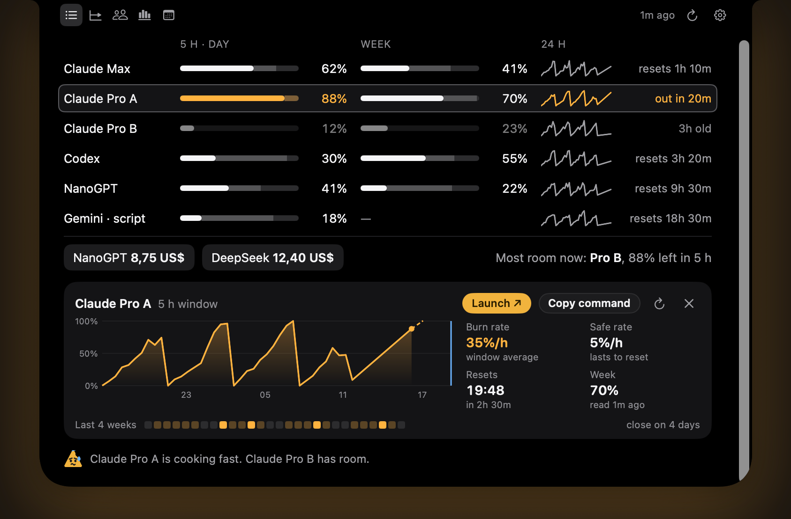
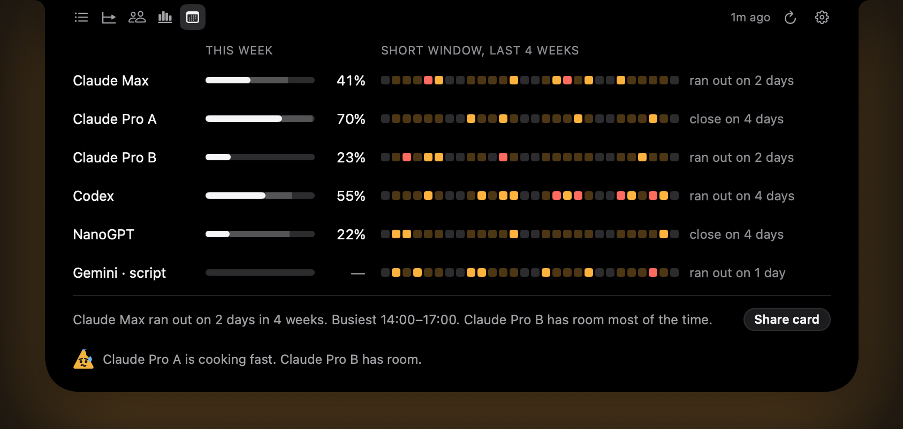
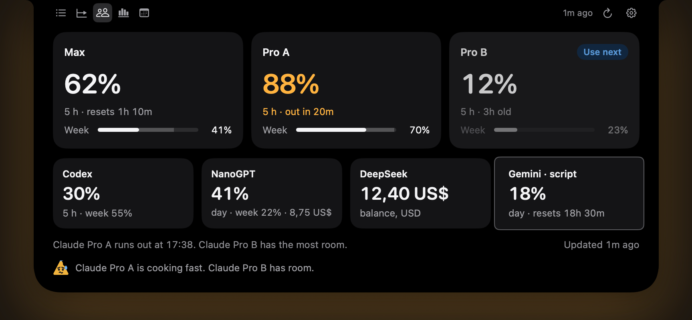

# Nacho Limits

Your AI plan limits in the MacBook notch: how much of each window you've used, when you'll run out at your current pace, and which account still has room. Free, for macOS 15 or later.

This repository hosts the signed, notarized releases and the update feed (`appcast.xml`) the app reads. Website: https://nacholimits.hexadexa.io



## Install

- **Download:** [NachoLimits.dmg](https://github.com/h3x4d3x4/NachoLimits-releases/releases/latest/download/NachoLimits.dmg), open it and drag Nacho Limits to Applications.
- **Homebrew:**
  ```sh
  brew tap h3x4d3x4/tap
  brew trust --cask h3x4d3x4/tap/nacholimits
  brew install --cask nacholimits
  ```
  This also installs the `nacho` command.

The app updates itself (Settings > General). On first launch it opens in the notch and walks you through connecting Claude Code.

## What it shows

- **Claude** (any number of accounts), from Claude Code's own status line
- **Codex**, from its session logs on your Mac
- **GitHub Copilot** premium requests, **OpenRouter**, **NanoGPT**, **DeepSeek** and **Kimi**, with your own keys
- **Anything else** through small scripts that print JSON ([how](https://nacholimits.hexadexa.io/scripts)), including ready-made ones for Anthropic and OpenAI API spend

Closed, it shows the tightest limit beside the notch. Open, it has five views (List, Timeline, Accounts, Meters, Week), a detail for every row, alerts before you run out, and the account to use next. On screens without a notch it lives in the menu bar. Desktop widgets, Shortcuts and a `nacho` command for Terminal are included. English and Portuguese.

| Week | Accounts |
|---|---|
|  |  |

## Privacy

Everything stays on your Mac. The app never reads or stores Claude or Codex login tokens. Keys are kept in your Keychain and only sent to their own service. No analytics, no accounts. Full details: https://nacholimits.hexadexa.io/privacy.html

## Releases

Each [release](https://github.com/h3x4d3x4/NachoLimits-releases/releases) lists what changed. The download is always named `NachoLimits.dmg`, signed with a Developer ID and notarized by Apple.

Questions: andrei@hexadexa.dev
